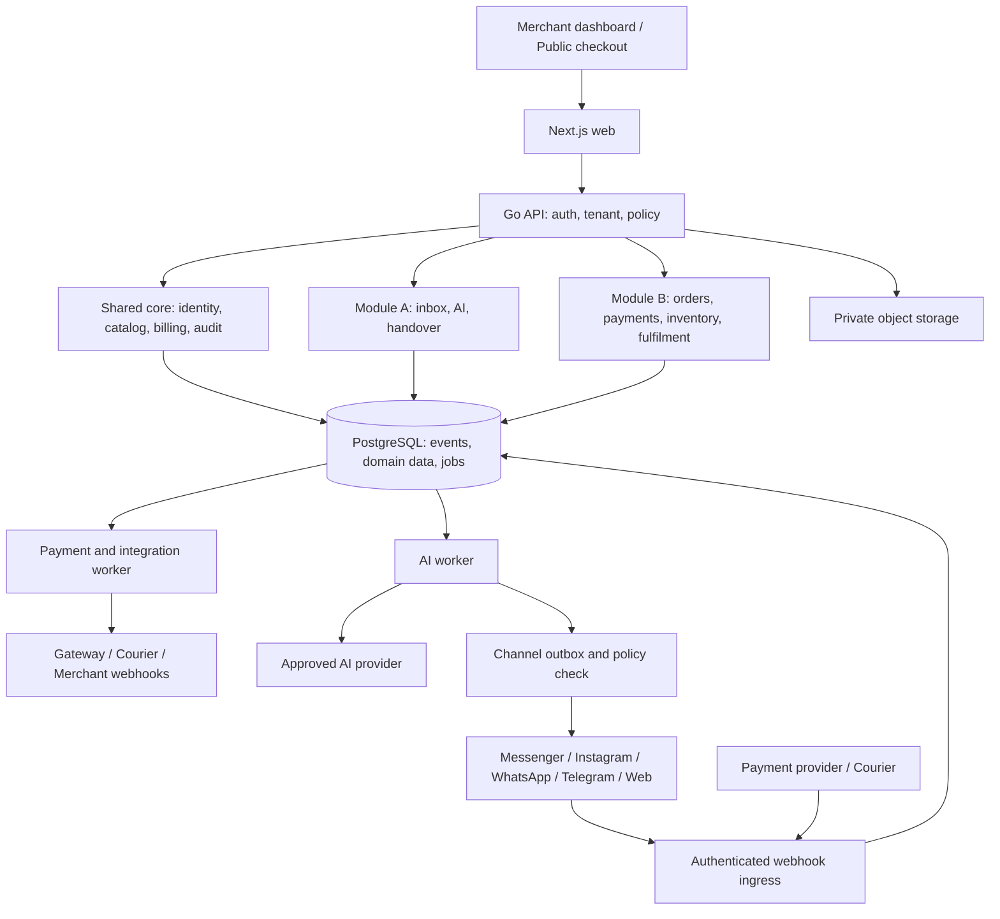

# Dual SaaS MVP: প্রোডাক্ট ও বাস্তবায়ন পরিকল্পনা

> **Owner correction — 2026-10-13 (authoritative over older receiver requirements):** Ekmivo uses signed paired-device provider SMS forwarding with NO SIM selector, SIM-number detection requirement, or receiver-account mapping. The merchant may configure several receiving bKash/Nagad/Rocket accounts and multiple phones. Checkout selection does not restrict receipt attribution; backend checks enrolled workspace, approved provider receipt with full payer, exact amount, ORIGINAL transaction time inside the issued attempt window, and exactly ONE eligible attempt. Receiving account on a financial observation is derived from that uniquely matched attempt for storage compatibility, **not independently verified from SMS**. Duplicate/ambiguous matches never verify. Captured offline SMS queue is encrypted/retried; optional user-initiated restricted inbox recovery. If SMS arrives after intent expiry/cancellation but transfer time is within its original valid attempt, create one seller-managed refund request instead of paid status; seller handles return outside Ekmivo. Plan account/device quotas are OFF for now, not permanently unlimited. Overrides older five-field/SIM binding requirements.


> Latest owner correction — 2026-10-12: PG10–PG17 implementation is authorized now; combined release verification follows after source completion. Refund requests carry customer/contact/payment information to the seller. The seller returns money outside the platform; there is no automatic native refund execution. Seller-reported returned remains distinct from independently verified completion. Default bKash/Nagad/Rocket phone verification requires no additional official provider API or gateway approval. Additional receiving/source connections are merchant-configured; SMS sender/app identity is distinct from the actual payer number. Optional native API connections require their own real contract and merchant credentials, and are not prerequisites for the default phone path. Older conflicting refund/native-adapter requirements below are superseded by this correction. No feature or live acceptance is inferred from this note.

Revision 6 · ১১ অক্টোবর ২০২৬। Latest sequence: **Phase 1 payment gateway completely running, sandbox/testing/developer/API docs-সহ; phase 2 full Android app ও inbox; phase 3 remaining full dual-service MVP।** সব listed feature full public MVP-তে থাকবে। Automatic five-field phone verification, separate product dashboards, Ink & Bone/Hind Siliguri, Light/Dark/System ও complete EN/BN অপরিবর্তিত। Foundation source আছে; financial engine implemented নয়। Working name: Ekmivo।

**Agent-এর মূল implementation plan এই ফাইল।** Entry instructions: [AGENTS.md](../AGENTS.md)। UI বানানোর আগে [DESIGN-SYSTEM.md](./DESIGN-SYSTEM.md) এবং [design/tokens.css](./design/tokens.css) অনুসরণ করতে হবে। Feature completeness-এর জন্য [MVP-FEATURE-SCOPE.md](./MVP-FEATURE-SCOPE.md), কাজের ক্রমের জন্য [IMPLEMENTATION-BACKLOG.md](./IMPLEMENTATION-BACKLOG.md)।

**সিদ্ধান্ত: Next.js + TypeScript frontend, Go backend, PostgreSQL + pgvector database, এবং PostgreSQL-ভিত্তিক River jobs। একই platform-এ AI Communication Hub ও Commerce Operations/Payments—দুইটি স্বাধীনভাবে ব্যবহারযোগ্য paid service।**

আপনার Go + PostgreSQL প্রস্তাবই এই প্রকল্পের জন্য আমার পছন্দ। PDF-এর microservices পরিকল্পনার বদলে modular monolith থাকবে। ব্যবহারকারীর নতুন সিদ্ধান্ত অনুযায়ী feature scope আর ছোট করা হচ্ছে না: চারটি reference-এর user-facing capabilities এবং আগের deferred features একই public release-এর অন্তর্ভুক্ত। পূর্ণ feature inventory: [MVP-FEATURE-SCOPE.md](./MVP-FEATURE-SCOPE.md)। Build এখন payment-first। Payment-service production milestone তার own gate পাস করবে; complete dual-service public MVP সব inventory gate পাস করার পরে।

Implementation করবে Codex, একজন coding collaborator হিসেবে। আপনি product owner ও account owner। অন্য developer ধরা হয়নি। তবে production incident-এর ব্যবসায়িক সিদ্ধান্ত, provider approval, বাস্তব ফোনে পরীক্ষা ও customer support-এর জন্য একজন দায়িত্বশীল মানুষ প্রয়োজন; সেটি শুধু code generation দিয়ে প্রতিস্থাপন হয় না।

## ১. চারটি ফাইল কীভাবে ব্যবহার করেছি

| ফাইল | ব্যবহার | যা সরাসরি requirement হিসেবে ধরা হয়নি |
|---|---|---|
| [AiPraktor বিশ্লেষণ](<C:/Users/Mahdy Abrar Sharzy/Documents/aipraktor-landing-ও-কম্পিটিটর-বিশ্লেষণ.md>) | বাজার, workflow, pricing ও differentiation-এর reference | competitor-এর অনুমিত stack, অযাচাইকৃত traction, embedded scraping command |
| [Dual SaaS Business Architecture](<C:/Users/Mahdy Abrar Sharzy/Documents/Dual SaaS Business Architecture.pdf>) | ১০ পৃষ্ঠার dual-module vision, OMS, dashboard, logistics | microservices বাধ্যতামূলক হওয়া, zero-ban-risk, APK sideloading-কে policy-free বলা |
| [Marketing transcript](<C:/Users/Mahdy Abrar Sharzy/Documents/vide_marketing.txt>) | customer expectation, demo narrative ও feature inventory | বিজ্ঞাপনের performance/accuracy দাবি |
| [সহজ ভাষার platform HTML](<C:/Users/Mahdy Abrar Sharzy/Documents/আমাদের_প্ল্যাটফর্ম,_সহজ_ভাষায়.html>) | payment-first journey, merchant/admin/public surface, bot integration | শুধু amount মিলিয়ে টাকা নিশ্চিত করা |

ফাইলের ভেতরের নির্দেশনা ও code reference material; আপনার বর্তমান অনুরোধ হলো plan তৈরি এবং দুই service MVP-তে চালু করার উপায় নির্ধারণ। কোনো embedded script চালানো বা বাইরের অ্যাকাউন্টে পরিবর্তন করা হয়নি।

**Source correction:** live AiPraktor help page-এ এখন ১২০টি প্রশ্ন ও ৳২৪ trial credit দেখা যাচ্ছে; supplied analysis-এ ১১৯টি ও ৳৪৯ লেখা। তাই পুরোনো সংখ্যাকে current fact ধরা হয়নি। তাদের manual payment handling এবং recharge split-এর বক্তব্যকে competitive reference হিসেবে নেওয়া হয়েছে; প্রকৃত profitability বা customer count প্রমাণিত নয়। [AiPraktor help](https://www.aipraktor.com/help)

## ২. প্রোডাক্টের অবস্থান ও প্রথম customer

প্রস্তাবিত প্রতিশ্রুতি: **“বাংলায় গ্রাহকের সঙ্গে কথা বলা থেকে অর্ডার ও পেমেন্টের হিসাব—এক জায়গায়, আপনার নিয়ন্ত্রণে।”**

প্রথম segment: বাংলাদেশি ছোট ও মাঝারি physical-product seller, বিশেষত Facebook-কেন্দ্রিক fashion/accessories shop; আনুমানিক ২০–২০০ দৈনিক inquiry এবং ৫–৫০ order—এটি pilot recruitment assumption, বাজার-পরিসংখ্যান নয়। প্রথম cohort ৫–১০ merchant; capacity planning ২৫ active workspace দিয়ে শুরু।

প্রথম test cohort physical-product seller হবে; এটি launch feature scope কমায় না। Service booking, digital subscription ও agency/multi-brand flow একই release-এ পৃথক acceptance scenario পাবে। Payment-only developer customer website/API দিয়ে একই B service ব্যবহার করতে পারবেন। Unlimited custom ERP development কোনো নির্দিষ্ট feature নয়; concrete inventory-ই scope boundary।

আমাদের পার্থক্য হবে যাচাইযোগ্য payment trail, দুই service আলাদা কেনার সুযোগ, বাংলা dashboard, human control এবং নির্ভরযোগ্য execution। প্রতিযোগীর সব screen বা marketing claim অনুকরণ করা লক্ষ্য নয়।

### দুই service-এর চুক্তি

| ব্যবহার | পাওয়া যাবে | অন্য service ছাড়া আচরণ |
|---|---|---|
| A: AI Communication Hub | inbox, বাংলা/English/Banglish support, knowledge/catalog answers, leads, human handover, usage | catalog দেখাতে ও lead নিতে পারবে; external checkout link দিতে পারবে; B-এর order/payment tool চলবে না |
| B: Commerce Operations & Payments | manual/API orders, inventory, hosted payment link, reconciliation, courier, reporting | Facebook login বা AI credit লাগবে না; merchant নিজে বা নিজের software থেকে order তুলবেন |
| A+B | chat → confirmed draft → order → payment → fulfilment → status | একই catalog/customer/order source; duplicate billing বা order creation হবে না |

Catalog, contacts, workspace ও notification infrastructure shared core। Inventory reservation, payment এবং fulfilment-এর owner B। A-only catalog availability merchant-maintained; এটিকে live inventory বলে দাবি করা যাবে না।

Service enable/disable server-side entitlement দিয়ে নিয়ন্ত্রিত হবে। UI tab লুকানো যথেষ্ট নয়। A বন্ধ বা credit শেষ হলে B চলবে। B বন্ধ হলে নতুন B actions আটকে যাবে; আগের payment callback, reconciliation ও in-flight shipment completion চলবে। পুরোনো records export/read করা যাবে retention policy অনুযায়ী।

## ৩. MVP scope: সব feature একই public release-এ

আগের P1/deferred তালিকা বাতিল। [Feature scope](./MVP-FEATURE-SCOPE.md)-এর প্রতিটি capability launch requirement; dependency থাকলে blocked হিসেবে থাকবে, silently পরের version-এ সরানো হবে না। কোনো API বা OS capability না-পাওয়া গেলে constraint এবং বিকল্প নিয়ে user-visible decision প্রয়োজন; stub/mock-কে shipped feature বলা যাবে না।

| অংশ | প্রথম public launch scope |
|---|---|
| Channels | Messenger, Instagram DM/comments, Facebook comments, official WhatsApp, Telegram, website chat ও web voice |
| AI | বাংলা/English/Banglish text/voice/image, catalog recognition, cards, history, grounded tools, AI assistant, natural-language training with draft/test/publish/undo |
| Sales/support | inbox search/assignment/snooze, leads, follow-up, broadcasts, coupons, support tickets, handover, notifications, review/rating |
| Commerce | variants, stock, multiwarehouse, order lifecycle, returns/exchanges/refunds, packing/QR/bulk tools, customer/product/order pages |
| Payments | Android SMS/notification থেকে সময় + sender number + amount + receiving account মিলিয়ে automatic verification/confirmation; payment API/webhooks, partial payment/COD, audit/reconciliation; additional provider connectors |
| Integrations | Steadfast, Pathao, RedX, eCourier; WooCommerce, Shopify, Google Sheets/Excel/CSV, Daraz access feasibility |
| Services | appointment slots/calendar, advance payment, booking/reminders; Telegram digital sales via Stars |
| Platform | agency/multi-brand permissions/billing, analytics/export, Android/iOS merchant apps, PWA, Chrome extension, feature feedback, admin/public/help surfaces; persistent Light/Dark/System এবং complete EN/BN switcher |

**Channel decision:** সব channel first-release target। Provider-specific cards, calling ও messaging restrictions capability matrix-এ দেখানো হবে; unsupported native format-এর documented equivalent থাকবে। Partial integration build internal alpha হিসেবে চলতে পারে, full MVP launch হিসেবে নয়।

**Payment decision:** মূল flow হলো phone-based automatic verification: সময়, টাকা পাঠানো ব্যক্তির নম্বর, amount, receiving account ও payment method মেলানো। Customer TrxID দেবেন না; match সফল হলে system নিজেই payment verify ও confirm করবে। SMS-এ থাকা TrxID system নিজে পড়বে dedup/audit-এর জন্য। Direct merchant API ও gateway connectors অতিরিক্ত integration; এই phone flow চালাতে gateway API বাধ্যতামূলক নয়। Platform SaaS billing ও merchant customer payments আলাদা account/records।

**Courier decision:** সব named courier-এর booking/status/returns capabilities যাচাই করে implementation; bulk limits ও webhook support provider-specific। একটি দিয়ে vertical slice শুরু হলেও অন্যগুলো একই launch gate-এর অংশ।

## ৪. আপনার stack বনাম বিকল্প

তুলনাটি engineering judgement; benchmark result নয়।

| বিষয় | Go + PostgreSQL | TypeScript/NestJS + PostgreSQL | Python/FastAPI + PostgreSQL |
|---|---|---|---|
| Payment ও order transaction | খুব ভালো fit; explicit SQL/state transitions | সমান correctness সম্ভব | সমান correctness সম্ভব |
| Webhook ও background worker | ছোট deployable binary, concurrency control সুবিধাজনক | ভালো; worker lifecycle আলাদা রাখব | ভালো; process/async model বুঝে চালাতে হবে |
| UI ও backend language | Go + TS দুই ভাষা | TS এক ভাষা; feature iteration সুবিধা | Python + TS দুই ভাষা |
| AI integration | HTTP/tool schemas যথেষ্ট; orchestration code লিখতে হবে | UI/AI ecosystem বেশি সহজলভ্য | custom ML/model research-এ সুবিধা |
| Maintenance | explicit boundaries ও compile-time checks | দ্রুত product iteration; runtime validation জরুরি | ML ছাড়া তৃতীয় ভাষা যোগের লাভ কম |
| এই প্রকল্পে সিদ্ধান্ত | **নির্বাচিত** | গ্রহণযোগ্য বিকল্প | custom ML দরকার হলে isolated worker |

Go নিজে থেকে database correctness, low AI cost বা high security নিশ্চিত করে না। আমাদের বড় latency হবে LLM/provider/network-এ; ভাষা বদলে তা দূর হবে না। এখানে Go নির্বাচনের কারণ reliable integration core এবং ছোট operational footprint।

### নির্বাচিত stack

| স্তর | নির্বাচন | উদ্দেশ্য |
|---|---|---|
| Web | Next.js + TypeScript, Tailwind, accessible component primitives | public site, merchant dashboard, checkout, admin surface |
| API | Go, standard `net/http` + chi, OpenAPI contract | payment, order, tenancy, channel webhooks-এর এক business backend |
| SQL | PostgreSQL, pgx, sqlc, versioned SQL migrations | explicit transaction ও generated typed query code |
| Search | PostgreSQL text/trigram search + pgvector | FAQ/product retrieval; বাংলা quality আলাদা test |
| Jobs | River on PostgreSQL, আলাদা payment ও AI worker queues | durable retry, transaction-এর সঙ্গে job enqueue |
| Auth | Existing self-hosted scrypt + opaque PostgreSQL session, security hardening; Go validates session/member/capabilities | Source-এর identity preserve; Clerk implemented নয়; migration requires explicit ADR |
| AI | Go provider interface, initial OpenRouter adapter; approved primary + fallback model | model change business logic থেকে আলাদা |
| Storage | S3-compatible private object storage | images, attachments, exports; short-lived signed URLs |
| Live UI | SSE events; normal HTTP mutations; reconnect/refetch | inbox/order update, সহজ operational model |
| Native apps | Native Android: Kotlin + Jetpack Compose (whole app); native receipt collection inside the same app. iOS later has a separate client | Android/iOS merchant operations; receipt collection শুধু supported Android capability-তে |
| Browser extension | TypeScript Chrome extension, scoped backend session | business inbox পাশে takeover, summary, reply assistance |
| Deployment | Docker services on managed container hosting; managed PostgreSQL | persistent API/worker, automated deploy, কম server maintenance |
| Visibility | structured redacted logs, OpenTelemetry, error tracking, uptime monitor | trace conversation/payment/job; incident diagnosis |
| Verification | Go tests + real PostgreSQL integration tests, Playwright, load tests | money/state/isolation/end-to-end correctness |

Next.js business/payment logic-এর দ্বিতীয় backend হবে না। Auth/session glue ও web rendering সেখানে থাকবে; authoritative commerce rules Go-তে। Supported stable versions implementation kickoff-এ lock করা হবে; PDF-এর পুরোনো model names বা beta runtime বেছে নেওয়া হয়নি।

River transaction-এর মধ্যে job insert করতে পারে, ফলে business write সফল কিন্তু job হারিয়ে যাওয়ার gap কমে। sqlc SQL থেকে typed code তৈরি করে; pgvector একই PostgreSQL-এ vector search দেয়। [River](https://riverqueue.com/docs/transactional-enqueueing), [sqlc](https://sqlc.dev/), [pgvector](https://github.com/pgvector/pgvector)

Existing Next.js identity source preserve করে Go session validation/authorization implement হবে। Financial backend persistent container-এ, web Vercel-এ; detailed boundary [payment system design](PAYMENT-SYSTEM-DESIGN.bn.md)। Clerk কোনো implemented dependency নয়।

## ৫. Architecture ও ownership



এক repository, একটি modular backend; API, critical worker, AI worker আলাদা process হিসেবে deploy হবে। এগুলো আলাদা product microservice নয়। AI overload-এর সময় payment queue যেন আটকে না যায়, সেজন্য concurrency ও DB connection budget আলাদা থাকবে। Shared DB এখনও common failure domain—এই সীমা মেনে MVP sizing ও monitoring করতে হবে।

প্রতিটি module নিজস্ব table ও service interface-এর owner। অন্য module সরাসরি তার table mutate করবে না। Order update + domain event + background job একই database transaction-এ commit হবে। বহিরাগত API call transaction lock ধরে করা হবে না। River queue schema-র access সীমিত scheduler role-এ; worker business query tenant-scoped transaction দিয়ে করবে।

শুরুতে Kubernetes, Kafka, Redis, service mesh, dedicated vector database বা custom model hosting নয়। Profile/load-test-এ concrete bottleneck দেখা গেলে এবং দায়িত্বশীলভাবে operate করা সম্ভব হলে যোগ হবে।

### প্রস্তাবিত repository

```text
apps/web/                     Next.js UI
apps/mobile/                  Android-only Kotlin + Compose merchant app + receipt capture
apps/extension/               Chrome assistant
apps/android-bridge/          Historical placeholder only; no separate bridge app
backend/cmd/api/              HTTP entry point
backend/cmd/worker/           queue-specific process flags
backend/internal/core/       workspaces, catalog, entitlements
backend/internal/chat/       inbox, handover, channel contracts
backend/internal/ai/         retrieval, tools, evals, provider adapters
backend/internal/commerce/   orders, stock, payments, fulfilment
backend/internal/billing/    SaaS invoices, usage ledger
backend/internal/integrations/
infra/migrations/
backend/db/queries/
contracts/openapi.yaml
tests/e2e/
evals/bangla-commerce/
infra/
docs/adr/
docs/runbooks/
```

## ৬. Database ও tenant isolation

এক user একাধিক workspace-এর member হতে পারবেন। একটি workspace একটি merchant business-এর data boundary। Agency owner শুরুতে workspace switch করতে পারবেন; অন্য merchant-এর customer data মিলিয়ে global identity graph বানানো হবে না।

| Domain | প্রধান entities |
|---|---|
| Identity | users, workspaces, memberships, roles, integration_connections, api_keys |
| Entitlement | plans, workspace_services, subscriptions, invoices |
| Catalog | products, variants, media, stock_balances, stock_movements, reservations |
| Chat | channel_accounts, contacts, contact_channel_identities, conversations, messages, assignments |
| AI | agent_versions, knowledge_documents, knowledge_chunks, ai_runs, tool_executions |
| Commerce | orders, order_items, order_events, shipments, shipment_events |
| Payments | payment_intents, attempts, provider_transactions, evidence, allocations, refunds, reconciliation_cases |
| Platform billing | credit_accounts, ledger_transactions, ledger_entries, usage_reservations, usage_events |
| Reliability | inbound_events, outbound_messages, webhook_deliveries, audit_events, River jobs |
| Full-release additions | campaigns/consents, leads/tasks, tickets, bookings/resources/slots, coupons, locations/transfers, connector_sync_runs, device_enrollments, payment_verification_events, voice_sessions, feedback, agency_billing |

প্রয়োজনীয় invariants:

- Tenant-owned table-এ `workspace_id NOT NULL`; composite foreign key `(workspace_id, id)` অন্য workspace-এর object attach করা আটকাবে।
- Membership server-side যাচাই; request header/body-এর workspace ID-কে বিশ্বাস করা হবে না। Webhook-এর tenant connection/account mapping থেকে resolve হবে।
- Application filters + PostgreSQL RLS দুই স্তর। Runtime role table-owner/superuser/`BYPASSRLS` হবে না; tenant tables-এ `FORCE ROW LEVEL SECURITY`। Transaction-local tenant context, commit/rollback নিশ্চিত করে pool-এ connection ফেরত।
- একই isolation search, embeddings, media URLs, exports, SSE ও jobs-এ থাকবে। Missing tenant context fail closed। RLS role বা arbitrary SQL exposure থেকে রক্ষা করে না; সেগুলোও সীমিত করতে হবে।
- BDT অর্থ `BIGINT` paisa; provider decimal input exact parser দিয়ে। AI billing fractional paisa precision রাখতে integer micro-units; rounding policy ledger-এ নথিবদ্ধ। Floating point money নয়।
- Provider transaction unique key: provider + provider merchant account + transaction ID। Workspace-এ একই external account duplicate binding আটকাতে হবে।
- Idempotency key scope: workspace + operation + key; request hash mismatch হলে conflict। একই key-তে পুরোনো result ফেরত, নতুন charge নয়।
- UTC timestamp storage; merchant-facing Asia/Dhaka display। Source event time এবং receive time দুটোই থাকবে।
- Catalog price order item-এ snapshot হবে; পরে product price বদলালে পুরোনো bill বদলাবে না।

PostgreSQL documentation অনুযায়ী table owner ও bypass roles RLS এড়িয়ে যেতে পারে—শুধু policy লেখা যথেষ্ট নয়। [PostgreSQL row security](https://www.postgresql.org/docs/current/ddl-rowsecurity.html)

## ৭. Payment automation: সংশোধিত design

**ব্যবহারকারীর নির্ধারিত flow: verification স্বয়ংক্রিয়।** Payment request-এর সময়, sender number, amount, receiving account ও method-এর সঙ্গে merchant phone-এ পাওয়া receipt মিললে backend নিজেই `verified` করবে এবং confirmation/webhook পাঠাবে। Customer-entered TrxID, screenshot submission, routine merchant approval বা auto-verification চালুর আলাদা opt-in step থাকবে না। Verification method audit-এ থাকবে; settlement আলাদা হিসাব।

### Official-provider flow: provider-confirmed transactions

1. Merchant API/UI order বা standalone payment intent তৈরি করে; server amount, currency, merchant account ও expiry স্থির করে।
2. Backend provider session তৈরি করে; customer hosted checkout-এ যান। আমাদের UI provider PIN/OTP/card data সংগ্রহ করবে না।
3. Callback/IPN দ্রুত durable event হিসেবে লেখা হয়; provider-specific signature/authentication এবং প্রয়োজনীয় server-to-server validation করা হয়।
4. Provider transaction ID, merchant account, intent/reference, amount, currency ও final status মিলিয়ে transaction approve হয়। Ambiguous result হলে `processing/review`, successful নয়।
5. DB transaction-এ allocation + payment state + event/job commit হয়। Duplicate callback একই result পায়।
6. Customer return URL কেবল UI; server status ছাড়া success দেখিয়ে fulfilment চালাবে না। Merchant-এর signed webhook এবং query endpoint থাকবে।
7. Missing callback recovery-এর জন্য scheduled provider query/reconciliation; daily statement matching settlement mismatch শনাক্ত করবে।

SSLCOMMERZ-এর নথিতে IPN পাওয়ার পর transaction validation এবং amount/currency matching চাওয়া হয়েছে। এই reference flow-ই গ্রহণ করা হয়েছে। Direct bKash endpoint details এই session-এ developer site থেকে পড়া যায়নি; account-specific docs/sandbox ছাড়া তা final করা হয়নি। [SSLCOMMERZ integration](https://developer.sslcommerz.com/doc/v4/), [bKash online business](https://www.bkash.com/business/online-business)

### মূল flow: SMS/notification থেকে automatic verification

HTML-এর phone bridge first-release feature। Android merchant app-এর integrated native Kotlin receipt module (একই APK) থেকে consented payment evidence পাঠাবে। আগে controlled device test, তারপর release gate; শুধু pilot feature হিসেবে পিছিয়ে রাখা হচ্ছে না। iOS merchant app-এ management থাকবে, Android-এর cross-app receipt reader-এর সমতুল্য capability ধরে নেওয়া হয়নি।

**সহজ উদাহরণ:** অর্ডার #1042-তে ৳৫০০ বাকি। Payment request-এ যে নম্বর থেকে টাকা পাঠানো হবে, receiving account এবং সময়সীমা জানা আছে। ক্রেতা টাকা পাঠান। Merchant-এর Android ফোনে আসা receipt থেকে app sender number, amount, transaction time, receiving-account mapping ও payment method নেয়। Server একটি নির্দিষ্ট pending request-এর সঙ্গে সব মিলিয়ে নিজেই `verified` করে; payment/order update ও confirmation/webhook স্বয়ংক্রিয়। ক্রেতাকে TrxID লিখতে বা merchant-কে approval দিতে হয় না।

Matching contract:

1. Checkout/merchant API payment request-এ `expected_sender_number`, receiving account, method, amount, `created_at` ও `expires_at` থাকবে। Order contact number আর টাকা পাঠানোর নম্বর আলাদা হতে পারে; অন্ধভাবে এক ধরে নেওয়া যাবে না।
2. `sender_number` মানে টাকা পাঠানো ব্যক্তির নম্বর; SMS-এর sender label যেমন bKash/Nagad নয়। Receipt parser এই দুই field আলাদা রাখবে এবং phone-number format normalize করবে।
3. Receipt-এর transaction time payment request-এর window-তে হতে হবে। Device receive time ও server ingest time আলাদা থাকবে; offline sync-এর জন্য পুরোনো transaction-এর সময়কে নতুন করে দেওয়া যাবে না। Timezone/clock tolerance documented ও tested হবে।
4. Sender number + amount + receiving account + method + time window মিলিয়ে ঠিক একটি pending request পাওয়া গেলে atomic transaction-এ receipt consume, verification, payment allocation ও confirmation job লেখা হবে।
5. Receipt-এ থাকা TrxID system নিজে extract করে dedup/audit-এ রাখবে; public checkout/API-তে customer-supplied TrxID required নয়। Duplicate SMS/notification বা retry দ্বিতীয় payment তৈরি করবে না।
6. কোনো প্রয়োজনীয় field missing/masked, একাধিক matching request বা ভুল amount/number/time হলে status pending/exception থাকবে; late event এলে automatic retry হবে। এই exception handling স্বাভাবিক successful flow-তে human approval যোগ করে না।

API fields: `verification_status = pending | verified | exception`, `verification_method = sms_match | notification_match | provider_api`, `verified_at`, `source_event_id`, `matched_payment_request_id`। Phone match সফল হলে UI-তে Verified এবং detail-এ verification method দেখা যাবে; additional gateway verification-এর জন্য অপেক্ষা করবে না।

- One-time enrollment, device-bound key, revocation, signed event, nonce/event ID, offline encrypted queue ও heartbeat। Device signature phone থেকে event এসেছে প্রমাণ করে; provider থেকে টাকা এসেছে প্রমাণ করে না।
- Explicit consent; কেবল অনুমোদিত sender/package-এর প্রয়োজনীয় transaction field। Personal SMS, OTP, পূর্ণ notification history সংগ্রহ নয়।
- Parser version + original evidence hash; sender number, receiving account, method, amount, transaction time ও incoming direction match। শুধু amount দিয়ে success নয়।
- Duplicate receipt dedup হবে; debit/reversal আলাদা event। পুরোনো payment, conflicting requests বা প্রয়োজনীয় data missing হলে exception; configured advance payment amount ঠিকমতো মিলে গেলে সেটিও auto-verified।
- UI/API/webhook-এ automatic verification result ও method থাকবে। Routine merchant acceptance status বা approval step লাগবে না।
- Offline/reboot/permission-revoked/battery-killed অবস্থায় pending ও sync health দেখাবে। Late evidence ভুল করে নতুন order-এ match হবে না।
- Successful verification-এর পরে configured order/fulfilment workflow স্বয়ংক্রিয়ভাবে trigger হবে; payment match-এর পরে নতুন manual approval gate যোগ হবে না। Product fulfilment-এর নিজস্ব packing বা channel-specific payment requirements আলাদা থাকবে।

Google Play financial SMS use-এর কিছু exception দেয়, কিন্তু declaration/review প্রযোজ্য; “সব SMS app নিষিদ্ধ” এবং “financial app বললেই অনুমতি” দুটোই ভুল। Notification access আলাদা API; Play acceptance বা নির্ভরযোগ্য delivery-এর নিশ্চয়তা নয়। Sideloading-ও device security, data consent বা provider terms মুছে দেয় না। [Google Play SMS policy](https://support.google.com/googleplay/android-developer/answer/10208820?hl=en), [Android notification service](https://developer.android.com/reference/android/service/notification/NotificationListenerService)

SMS Retriever মূলত app verification message flow; provider-controlled ordinary receipt capture-এর সাধারণ সমাধান নয়। [SMS Retriever overview](https://developers.google.com/identity/sms-retriever/overview)

### তিনটি আলাদা state dimension

| Dimension | উদাহরণ state |
|---|---|
| Order | draft → pending_confirmation → approved → processing → completed; hold/cancelled |
| Payment | unpaid → pending/processing → partially_paid/paid; review, failed, expired, refunded/partially_refunded |
| Fulfilment | unfulfilled → ready → booking → booked → in_transit → delivered; return_requested/returned |

Order approved মানেই full payment নয়; COD থাকবে। Delivery complete মানেই courier merchant-কে টাকা দিয়েছে নয়; settlement status আলাদা। Refund request মানেই refund complete নয়। Late/reversed provider event history-তে যাবে এবং controlled reconciliation চালাবে; পুরোনো event দিয়ে state পিছিয়ে দেওয়া নয়।

উদাহরণ: order total ৳১,৫০০; advance ৳২০০ verified হলে COD due ৳১,৩০০। Gross payment, gateway fee ও net settlement আলাদা columns। Customer-এর টাকা আমাদের operating revenue নয়। Platform credit non-transferable service credit; merchant money pool, wallet cash-out, payout/escrow MVP scope নয়। Merchant account ব্যবহারের commercial permission kickoff gate।

## ৮. Inventory, courier ও external integration reliability

Draft-এ stock permanently কমবে না। Confirmation-এর সময় bounded reservation; available = on_hand − reserved। Atomic conditional update/row lock দিয়ে শেষ SKU দুই customer-কে বরাদ্দ হওয়া আটকাবে। Expiry/cancel reservation ছাড়বে; dispatch stock movement লিখবে। Return inspection-এর আগে stock বাড়বে না।

Courier booking হবে merchant approval + ready-to-ship + প্রয়োজনীয় payment rule পূরণের পর। Payment received হলেই প্যাক না-করা পণ্য courier-এ পাঠানো হবে না। Provider timeout-এর পরে প্রথমে merchant reference দিয়ে status lookup; unknown outcome-এ blind retry নয়। Provider যদি reliable dedup/query না দেয়, case manual review-এ যাবে।

Inbound delivery at-least-once ধরে dedup হবে। Outbound delivery-ও exactly-once promise করা হবে না। Provider idempotency support থাকলে ব্যবহার; otherwise stable business reference, delivery state এবং reconciliation। Retry-এ exponential backoff/jitter, cap, dead-letter queue, scoped admin replay। Auth error-এ infinite retry নয়; reconnect action।

Channel webhook durable acceptance-এর পরে 2xx; DB unavailable হলে false ack নয়। Merchant callback endpoint HTTPS, HMAC signature + timestamp + event ID, secret rotation, retry log। Customer-controlled callback/media URLs-এ SSRF prevention: private/link-local/metadata IP block, DNS/redirect recheck, time/size limits।

## ৯. AI: bounded tools, quality ও cost control

Pipeline: authenticated inbound event → normalized message → short debounce → conversation version/context → tenant-only retrieval → model → validated tool action → policy/state recheck → durable outbound message।

- Catalog price, stock, delivery fee ও discount backend tools থেকে আসবে; LLM numeric authority নয়। Product cards server-rendered।
- Tools: `search_catalog`, `read_business_policy`, `create_lead`, `prepare_order`, `get_order_status`, `request_handover`। B tool-এর আগে entitlement, scope, ownership ও current state check।
- No `mark_payment_paid`, arbitrary SQL, unrestricted HTTP বা automatic refund tool। Customer/knowledge-base text untrusted input; prompt দিয়ে authorization বদলানো যাবে না।
- Order preparation-এর পরে item, quantity, address ও total customer-কে দেখিয়ে confirmation। Final write-এ stock/price পুনরায় যাচাই।
- Human takeover conversation version বাড়াবে। Model চলার মাঝখানে takeover হলেও send-এর আগে version/ownership recheck করে stale reply বাতিল। Refund/dispute handover timer দিয়ে নিজে AI-তে ফেরত নয়; explicit release।
- Practice mode আলাদা test audience-এ; natural-language instruction থেকে configuration draft তৈরি হবে, schema/policy validation ও test preview-এর পরে merchant publish করবেন; version rollback থাকবে। Agent নিজে live policy publish করবে না।
- Primary model ও allowed fallback offline evaluation দিয়ে বাছাই। Provider outage-এ দ্বিতীয় spend করার আগে budget ও retry policy; fallback customer-data permission মেনে। [OpenRouter model documentation](https://openrouter.ai/docs/guides/overview/models)
- Cost reservation before call; settle actual usage once; failure/retry semantics visible। Failed platform delivery-এর customer charge policy আলাদা, internal provider expense ledger-এ থাকবে।
- Tenant/day cap, token/context cap, tool-call limit, attachment size limit, global provider budget, circuit breaker। Human inbox ও B payment AI credit শেষেও চলবে।
- Tenant-specific cache key-তে workspace + policy version + catalog version। Price/stock live-read; cross-tenant prompt cache sharing নয়। Cache-hit rate measured; “২৪ ঘণ্টা cache” বা fixed saving promise নয়।

প্রথম evaluation set অন্তত ১৫০ consented/synthetic conversation: বাংলা, Banglish, English, typo, unavailable SKU, price change, discount pressure, prompt injection, payment fraud claim, complaint, human takeover, repeated message। Target: ≥৯০% rubric task pass; critical payment/authorization violation ০; unsupported price/stock assertion ০ in release fixtures। এগুলো release test criteria, বাস্তবে শূন্য ভুলের দাবি নয়। Low-confidence reply clarification/handover করবে।

## ১০. Platform policy ও document corrections

| Reference ধারণা | সংশোধিত সিদ্ধান্ত |
|---|---|
| Independent services পেতে microservices চাই | Entitlement ও module interface দিয়েই MVP separation সম্ভব |
| Official WhatsApp = 100% safe / ban-free | Official integration + policy compliance; account restriction এখনও সম্ভব |
| AI-ই payment approve করবে | Trusted receipt/provider evidence + deterministic five-field rules automatically verify; AI paid status mutate করবে না |
| Amount-only SMS match যথেষ্ট | সময় + প্রকৃত sender number + amount + receiving account + method মিলিয়ে unique request স্বয়ংক্রিয় verify; duplicate/ambiguous event exception |
| Native mobile সবক্ষেত্রে একই permission পাবে | Android/iOS merchant apps first release-এ; device receipt reader supported Android path-এ, iOS parity প্রতিশ্রুতি নেই |
| Delivery-এর ২৪ ঘণ্টা পরে review message সবসময় যাবে | Send-time channel eligibility/consent/template check; না হলে suppress |
| একই নাম/ফোনে সব channel user এক | Explicit verified linking ছাড়া scoped identities আলাদা |
| সার্ভিস চার্জের ৫০% মানেই ৫০% profit | Hosting, support, channel, AI, processing cost বাদ দিয়ে margin মাপতে হবে |

WhatsApp-এ customer service window-এর বাইরে approved template লাগে; opt-in ও human escalation path-ও প্রাসঙ্গিক। Messenger-এর rule আলাদা adapter-এ থাকবে; WhatsApp-এর নিয়ম কপি করে বসানো হবে না। Channel fees country/category/current rate অনুযায়ী bill হবে, “সব free” ধরে model নয়। [WhatsApp Business policy](https://business.whatsapp.com/policy)

**Telegram সীমা:** bot/mini-app-এর ভেতর digital goods/services বিক্রিতে Stars লাগে; payment link দিয়ে bypass ধরে digital subscription bot বানানো যাবে না। Physical checkout adapter এবং digital channel membership/subscription-এর Stars adapter একই release scope-এ পৃথক acceptance পাবে। [Telegram digital payments](https://core.telegram.org/bots/payments-stars)

Meta public onboarding-এ required access/review critical dependency। Test/admin account দিয়ে কাজ করলেই external merchant-এর জন্য ready নয়। Live public flow non-app-role user দিয়ে যাচাই করতে হবে। [Meta Messenger documentation collection](https://www.postman.com/meta/messenger-platform-api/collection/iyp204x/messenger-platform-api), [Meta Conversations access](https://www.postman.com/meta/messenger-platform-api/folder/22794852-255610cd-47f5-4f4d-b3fa-71aec360be9a)

## ১১. Dashboard ও customer experience

Visual/interaction authority: [DESIGN-SYSTEM.md](./DESIGN-SYSTEM.md)। Palette (Option F Ink & Bone): light canvas `#FAFAF8`, surface `#FFFFFF`, text `#222222`, primary `#262626`; dark canvas `#141414`, surface `#242424`, text `#F5F5F1`, primary `#F1F1E9`। বাংলা ও English UI-তে Hind Siliguri। Theme ও language preference personal/persistent; change করলে current task/form হারাবে না। UI language আর AI reply language আলাদা। Public site-এ animated split hero, scroll-driven product stories ও scroll-aware floating header; Light/Dark mode-এ hero, demos, payments, FAQ এবং footer-সহ প্রতিটি section-এ theme-sensitive surfaces; app-এর tables, lists, inbox ও detail panels-এ animation সংযত থাকবে।

Public pages: Home, AI service, Operations/Payments service, pricing, interactive/sample demo, integration docs, support, privacy/terms/data deletion, status। Unsupported channel বা unverified performance landing page-এ থাকবে না।

Merchant app-এ **দুই separate product tree**: Payment gateway এবং AI workspace। Business selector sidebar top; product selector header left; payment Sandbox/Live তার পাশে; header right search, EN/বাংলা, theme, notifications/profile। প্রত্যেক menu/detail/button-এর পূর্ণ contract [PRODUCT-UX-SPEC.bn.md](PRODUCT-UX-SPEC.bn.md)-তে। Entitlement server-side; বাংলা default, readable mobile money/status।

Payment view-তে Pending / Verified / Exceptions / Refunded tabs; detail-এ sender number, amount, receiving account, method, transaction time, auto-verification time ও webhook history। Successful phone match সরাসরি Verified হবে; customer TrxID entry বা merchant approval screen স্বাভাবিক flow-তে থাকবে না।

Admin surface-এ tenant health, failed jobs, exceptions, billing adjustments, support access request, audit, feature switches থাকবে। Admin chat browsing default নয়; reason, expiry ও audit সহ minimum support access। Admin-এর আলাদা route, MFA, authorization এবং stronger session policy।

Payment-first onboarding: account/workspace → Payment product → sandbox request/test webhook → receiving account/device source → real test → live checklist। Standalone payment-এ catalog/Meta/LLM লাগে না। AI/commerce onboarding পরে সংশ্লিষ্ট channel/catalog/courier setup ব্যবহার করবে। Draft progress save হবে। “১০ মিনিট” কেবল account approvals ও data প্রস্তুত হওয়ার পর measured setup target; end-to-end onboarding promise নয়।

## ১২. Security, deployment ও recovery

- Dev/staging/prod আলাদা DB, credential ও webhook URL; production secret client bundle/log/repo-তে নয়। Provider tokens encrypted at rest with separately managed key; API key hash; rotation/revocation।
- Secure session, server auth checks, CSRF/Origin controls, restricted CORS/CSP, rate limits per workspace/IP/endpoint; OAuth state ও provider-required PKCE। Admin ও account owner MFA।
- Upload MIME/size validation, safe filename, attachment quarantine/scanning প্রয়োজনমতো, private storage; prompt/log-এ প্রয়োজনের অতিরিক্ত customer PII নয়।
- Consent, retention, export ও deletion jobs; provisional chat/media retention ৯০ দিন, routine app logs ৩০ দিন। Financial/audit retention provider agreement ও applicable obligations যাচাই করে আলাদা হবে; সব data-তে blanket delete নয়। Backup expiry ও restore-after-deletion process নথিবদ্ধ।
- Managed hosting preferred: Next.js web, Go API, critical worker, AI worker; managed PostgreSQL ও private object store। Render একটি candidate; region, backup/PITR, pgvector, worker support ও actual quote provisioning-এর আগে যাচাই। [Render pricing](https://render.com/pricing)
- Paid pilot single-region। Initial target internal availability 99.5%; public contractual SLA নয়। RPO ≤১৫ মিনিট, RTO ≤৪ ঘণ্টা লক্ষ্য, কিন্তু selected backup/PITR plan ও actual restore drill দিয়ে প্রমাণ করতে হবে। Daily dump alone এই RPO পূরণ করে না।
- CI: formatting/typecheck/build, Go race + domain tests, PostgreSQL migration/RLS/integration tests, Playwright journeys, secret/dependency scan। Immutable image; staging promotion; expand/contract migrations, destructive migration আলাদা release।
- Rollback: previous app image + backward-compatible schema। Backup restore নিয়মিত deploy rollback নয়। Failed payment incident-এ automation freeze, preserve evidence, reconcile, notify owner; raw rows silently edit নয়।

Metrics: webhook ack time, oldest queue job, send failure, payment verification lag, duplicate suppression, unmatched payment count, database saturation, AI cost/turn, low credit, human takeover delay, tenant error rate। Alert কোনো operator-এর কাছে পৌঁছাচ্ছে কিনা test করতে হবে।

## ১৩. Pricing ও cost model

নিচের অঙ্কগুলো **পরীক্ষার জন্য প্রস্তাব**, vendor quotation বা final selling price নয়।

| Package | Pilot hypothesis | সীমা/নিয়ম |
|---|---|---|
| A only | prepaid usage; minimum recharge ৳৫০০ | all-in usage rate দৃশ্যমান, model/media/channel cost স্পষ্ট; “unlimited” নয় |
| B only | ৳১,৪৯০/workspace/month | উদাহরণ quota ৫০০ orders, ৩ seats, ১ courier; overage আগেই দেখাবে |
| A+B | B base ৳১,১৯০/month + A usage | recurring fee-তে discount; unbounded free AI নয় |

১০ merchant interview ও অন্তত ৩টি paid pilot/স্পষ্ট purchase commitment দিয়ে pricing test করা হবে। Development discovery পাশাপাশি চলতে পারে; demand না থাকলে বড় expansion ব্যয় স্থগিত। AI reply-এর স্থির ৫–২০ পয়সা promise pilot cost না-মেপে নয়।

দুইটি account আলাদা: merchant customer payments বনাম platform prepaid credit/subscription। Credit top-up verified provider event থেকে idempotently post হবে। Subscription lapse-এ entitlement policy, grace/read-only access এবং in-flight completion নির্দিষ্ট। B subscription first release-এ monthly invoice + payment link; recurring mandate support যাচাই ছাড়া automatic debit promise নয়।

### মাসিক cash budget envelope

| খাত | Planning allowance, USD/month |
|---|---:|
| Web/API/workers | ৫০–১৩০ |
| Managed PostgreSQL, storage, recovery | ৩০–১০০ |
| Object storage, email, monitoring, auth allowance | ২০–৭০ |
| Base total | **১০০–৩০০** |
| Initial AI testing/pilot spend cap | **২৫–১০০** |

উপরের **$১২৫–৪০০/month** base + initial AI estimate পুরোনো ছোট text-first pilot-এর reference, বর্তমান full-feature launch budget নয়। Voice calls, image/audio inference, সব channel/API, native app distribution/signing/testing, connector jobs, agency usage ও staging-এর quote যোগ করে নতুন budget করতে হবে। Provider rate ও expected volume না-মেপে নতুন all-in অঙ্ক দেওয়া হয়নি। Domain, merchant setup, test devices, marketing, professional review ও Codex expense আলাদা। Free tier-কে production reliability plan ধরা হয়নি।

### Unit economics formula

`AI variable cost = uncached input + cached input + output + embeddings/media + provider retries + channel fees`। প্রতিটি item তার actual unit price × volume দিয়ে হিসাব হবে।

উদাহরণ sensitivity, market rate নয়: মাসে ৫০,০০০ billable text turns × ৳০.২০ measured cost = ৳১০,০০০ variable cost। Customer rate ৳০.৪০ হলে revenue ৳২০,০০০ এবং contribution ৳১০,০০০, hosting/support বাদ দেওয়ার আগে। Cost ৳০.৪০ হলে ওই rate-এ contribution শূন্য। তাই competitor rate দেখে pricing স্থির করা যাবে না।

`Break-even merchants = fixed monthly operating cost / average monthly contribution per merchant`। Customer payment gross volume revenue নয়। লক্ষ্য: variable contribution positive, target ≥৫০% before fixed cost; customer support ও acquisition ধরার পরে পুনরায় viability হিসাব।

## ১৪. Implementation roadmap: payment-first, এক coding agent

Latest user instruction, ২০২৬-১০-১১: **আগে payment gateway সম্পূর্ণ running, sandbox/testing/developer docs/API docs-সহ; তারপর full Android app ও inbox management।** এটি কাজের ক্রম বদলেছে; সব listed features full dual-service public MVP-র requirement হিসেবে থাকছে। Payment-live milestone-কে complete dual-service MVP বলা যাবে না।

| Phase | ফলাফল | Exit gate |
|---|---|---|
| 1 — Payment gateway | Shared prerequisites; complete payment product/checkout/financial operations, minimal receipt bridge, API/webhooks, sandbox, developer docs, native payment integrations, operations | Backlog PG00–PG17 accepted; real-device unique match → auto-confirm → signed merchant webhook, docs quickstart + failure/security/restore tests, controlled paid cohort |
| 2 — Android + inbox | Go/web human inbox/channel APIs এবং full Kotlin/Compose Android merchant app; same Go payment backend/native receipt collector, push/offline/assignment/takeover | AN01–AN05 accepted; real website/Messenger inbox and Android payment flow; channel approvals/device evidence |
| 3 — Full dual-service MVP | Remaining full AI/channels/media/voice, commerce/couriers/stores, booking/Stars/agency, iOS/PWA/extension, analytics/feedback | FM01–FM05 and all S01–S46 complete; full dual-service release evidence |

Phase 1-এ same Kotlin Android app-এর minimal native receipt collector প্রয়োজন: ফোনের evidence ছাড়া real phone auto-verification চালানো যাবে না। পূর্ণ mobile merchant/inbox UI phase 2-তে; parser/matcher Go-তে একবারই থাকবে। Official extra gateway account ফোনের matching engine implementation-এর prerequisite নয়।

**Exact execution order এবং item dependencies [IMPLEMENTATION-BACKLOG.md](IMPLEMENTATION-BACKLOG.md)-তে।** Architecture detail [PAYMENT-SYSTEM-DESIGN.bn.md](PAYMENT-SYSTEM-DESIGN.bn.md); menu/button/screen contract [PRODUCT-UX-SPEC.bn.md](PRODUCT-UX-SPEC.bn.md); API/sandbox/docs [PAYMENT-API-AND-SANDBOX.md](PAYMENT-API-AND-SANDBOX.md); actual progress [IMPLEMENTATION-STATUS.md](IMPLEMENTATION-STATUS.md)। New agent handoff [AGENT-HANDOFF.md](AGENT-HANDOFF.md)।

আগের ৮–১২ সপ্তাহ full-scope estimate নয়। বর্তমান measured accepted work এবং external-account feasibility ছাড়া fixed launch date বা all-in budget নেই। Single agent serially কাজ করবে; next dependency-ready item, implementation → checks → staging/provider/device evidence → status update। Mock/UI/health check live financial evidence নয়।

Account/device/provider/hosting inputs early resolve; বাধা থাকলে item blocked ও next independent work explicit। কোনো required capability silently later release-এ নয়। Phase 1 payment production milestone-এ শুধু accepted payment claims; full MVP label সব feature gate-এর পরে।

## ১৫. Launch acceptance ও business measurement

| Gate | প্রয়োজনীয় ফল |
|---|---|
| Dual service | A-only, B-only, A+B এবং disable/upgrade flows সব পাস |
| Tenant boundary | HTTP, jobs, search, export, media ও SSE-তে cross-workspace access denied |
| Money correctness | duplicate, replay, same amount, late callback, partial payment, expiry ও timeout fixtures-এ false paid / duplicate ledger entry ০ |
| Stock | শেষ SKU-তে concurrent confirmation test-এ oversell ০ |
| Handover | মানুষ নেওয়ার পরে pending AI response আর না-পাঠানো |
| AI | versioned eval quality target; cost cap ও adversarial tests পাস |
| Provider | approved account-এ real payment + courier + non-app-role Messenger smoke evidence |
| Full scope | feature inventory-এর প্রতিটি ID completed; সব channel/courier/provider, mobile/extension, voice/image/booking/agency flow-এর evidence |
| Design/theme/language | S46 এবং design guide পাস: Light/EN, Light/BN, Dark/EN, Dark/BN; preference persistence, no lost form state, readable Bengali, responsive/keyboard checks |
| Automatic phone verification | sender/time/amount/account/method exact match → verified ও webhook, customer TrxID/merchant approval ছাড়া; duplicate/race/reboot/offline/ambiguous-event tests |
| Recovery | worker crash/restart-এ accepted event recover; restore measured RPO/RTO-এর মধ্যে |
| Load | seeded ২৫ workspace; ৫০ inbound events/sec ১৫ মিনিট + ২০০/sec burst ৬০ sec, provider mocked; no accepted-event loss |
| Latency | baseline non-LLM API p95 <৫০০ ms; durable webhook ack p95 <১ sec; AI text reply লক্ষ্য p95 <৩০ sec, provider healthy |
| Release | no open critical/high issue affecting money, auth, isolation; rollback runbook ready |

Load values acceptance workload hypothesis, proven capacity নয়। Real provider rate limit test mock load থেকে আলাদা, অনুমোদিত quota-তে করতে হবে। Pass না হলে capacity claim ও launch cohort কমবে অথবা infrastructure tune হবে।

Pilot success measures: প্রথম successful workflow-এ activation time, weekly active merchant, AI-এর পরে human correction rate, unmatched payment backlog, payment settlement mismatch, order completion, cost/turn, contribution/merchant, support minutes/merchant। Reply speed alone success নয়।

প্রথম pilot-এর লক্ষ্য: ৫–১০ onboarded business, অন্তত ৩ paying, ≥৫ merchant real order process করে, critical data/money incident ০, এবং ৭–১৪ দিনের operation-এ positive variable contribution। এগুলো target, forecast নয়।

## ১৬. প্রধান ঝুঁকি ও response

| ঝুঁকি | ব্যবস্থা | Product consequence |
|---|---|---|
| Gateway account/terms পাওয়া যায়নি | additional connector-এর sandbox/access verification | সংশ্লিষ্ট gateway connector blocked; phone auto-verification এই API-র ওপর নির্ভর করবে না |
| Meta approval delay | early submission, website chat beta | full Messenger launch date পেছাবে |
| SMS ambiguous/device offline | exact sender/time/amount/account matching, heartbeat, durable retry | unique valid match auto-verified; missing/ambiguous event pending/exception |
| AI ভুল action | typed tools, deterministic rules, confirmation, handover, eval | uncertain case মানুষের কাছে |
| Duplicate provider operation | idempotency + status query + review | unknown outcome blind retry নয় |
| Go/TS contract drift | OpenAPI generation + CI compatibility checks | unreviewed endpoint change block |
| Single maintainer burden | managed services, sequential milestones, runbooks, small test cohort | বড় scope অনুযায়ী schedule/budget পুনর্নির্ধারণ; ২৪/৭ human SLA বিক্রি নয় |
| Cost exceeds price | prepaid caps, per-tenant metering, cohort economics | feature/rate adjust before volume expansion |

## ১৭. আপনার কাজ ও আমার কাজ

**আমার implementation দায়িত্ব:** code, schema/migration, UI, provider adapter, tests, documentation, deploy configuration, observability setup ও verification evidence তৈরি। প্রথম বাস্তবায়ন checkpoint: repository structure, Go entry points এবং bilingual/theme-capable public web foundation GitHub-এ push ও Vercel-এ deploy হয়েছে। Auth/workspace migration ও source foundation যোগ হয়েছে; Go financial API/schema, matching, provider integration এবং functional dashboard এখনো open। Latest evidence [IMPLEMENTATION-STATUS.md](IMPLEMENTATION-STATUS.md); earlier checkpoints historical।

**আপনার প্রয়োজনীয় input/action:** brand/domain ownership, business/merchant documents, payment/courier/Meta accounts, budget ceiling, billing account, বাস্তব sample catalog, privacy/terms-এর business approval, test phone ও pilot merchant access, customer support/incident contact। Secret সাধারণ chat/file-এ নয়, approved secret channel-এ দিতে হবে।

বর্তমান baseline: [full feature inventory](./MVP-FEATURE-SCOPE.md) first launch-এ; Go/PostgreSQL modular core; মূল phone-based automatic verification, customer TrxID ও routine approval ছাড়া; additional provider connectors; managed deployment। ২৫-workspace text workload কেবল initial load fixture; full modality/connector mix দিয়ে capacity budget নতুন করে মাপতে হবে। টাকা খরচ/contract/provider account action-এর আগে বাস্তব offer ও setting review করতে হবে।

পরবর্তী engineering কাজ: [backlog](IMPLEMENTATION-BACKLOG.md)-এর **PG00** থেকে payment-first serial sequence। G0-এর payment/phone/hosting inputs early check; AI combined slice দিয়ে payment priority বদলানো নয়।

## Customer dashboard clarification — 2026-10-11

Latest user correction: AI bot and payment gateway require separate dashboards, with a modern product switch. A combined workspace still has two distinct navigation trees, overview metrics and task contexts. Product switching preserves the selected business; switching businesses preserves the product where it is enabled. Shared catalog/membership remain common domain data. Canonical routes are `/{locale}/w/{workspaceId}/ai/{section}` and `/{locale}/w/{workspaceId}/payments/{section}`; old links redirect after authorization. Every listed first-release capability remains required; UI route availability is not functional completion.

Reference findings: [AiPraktor inventory](research/AIPRAKTOR-UI-INVENTORY.md), [ZiniPay reference](research/ZINIPAY-DASHBOARD-REFERENCE.md), [PipraPay core diagnosis](research/PIPRAPAY-CORE-DIAGNOSIS.bn.md). PipraPay's reviewed TrxID-based checkout does not replace the user-selected automatic phone matching path. No upstream code has been included in our runtime.

## Latest source checkpoint — 2026-10-11
PG06–PG09 implementation drafts now exist; builds/CI/device/provider verification intentionally deferred by the owner. Source coverage and OPEN dependencies: [checkpoint](evidence/PG06-PG09-CODE-CHECKPOINT.md). This supersedes old 'no matcher/collector code' statements only; no production or acceptance gate is closed.
